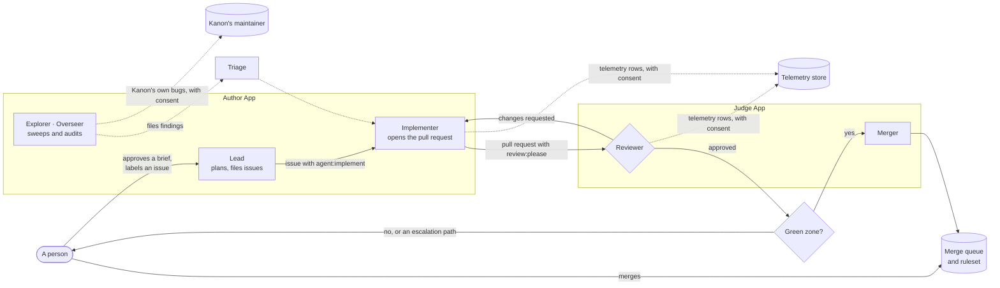

# Kanon's architecture

This page describes Kanon on one page: who acts, what starts them, what stops them, where data goes and where the rules are enforced. Each part links to the page with the details.

## Who acts: two Apps

Agents act through GitHub Apps, never through a person's token. An owner has two, reused across its repositories ([apps.md](apps.md), [ADR 0013](decisions/0013-personal-accounts-and-two-apps.md)):

| App | Roles | What it may do |
|---|---|---|
| **Author** | Lead, Implementer, Explorer, Overseer | write code, open pull requests, file issues |
| **Judge** | Reviewer, Merger | review and merge, never write code |
| **Releaser** (optional) | the release workflow | open release pull requests and push release tags |

Each App holds exactly the permissions its roles need ([`rulebook/agent-permissions.json`](../rulebook/agent-permissions.json)). Each lane narrows its token further, and the job that runs the agent never holds the App's key. Every comment an agent posts opens with its role, such as **Reviewer**, and a hidden role marker, so a check can tell which role wrote it.

## What starts them: lanes

A **lane** is a reusable workflow that runs one agent for one job. An adopter calls it from a small workflow in its own repository, pinned to a Kanon release. All 20 are listed with their triggers in [lanes.md](lanes.md):

| Family | Lanes | Started by |
|---|---|---|
| Reviewing | review, merge reconcile | the `review:please` label once CI finishes; a review or a merge |
| Building | implement, implement-revise, triage, rebase | the `agent:implement`, `agent:revise` or `qa:needs-triage` label; a review; CI on main |
| Planning | lead, lead-revise, lead-split, lead-reconcile, verify-acs | a person's dispatch with a mandate; labels; hourly |
| Merging | merge | an approval; CI on main; hourly |
| Exploring | explore, code audit, explore the telemetry | a schedule |
| Upkeep and reporting | dispatch sweep, issue backstop, Overseer, daily and weekly digests, release announcement | a schedule; an issue opened; a pull request put on a milestone, which the backstop takes off; a published release |

You don't install them all. `kanon init` offers three features: **Review** (the review lane alone), **Review + build** (adds the Implementer's lanes, the dispatch sweep, the issue backstop and merge reconcile) and the **full pipeline** (adds the Lead, the Merger, the audits and the daily project digest). Five lanes run no model at all: the Merger, the reconciler, the dispatch sweep, the issue backstop and the release announcement.

**The digests post to chat only through a notify hook** at `.github/actions/notify/action.yml`, run in each digest's `notify` job with one secret per kind of message ([notifications.md](notifications.md)). With the full pipeline, `kanon init` asks which hook that is: Kanon's Slack hook, Kanon's generic JSON webhook hook (each written pinned at the release `init` runs from, and moved by the upgrade with the callers), a stub of the adopter's own, or none. With none, the daily digest runs its health job alone and the weekly digest isn't installed ([init.md](init.md#the-chat-channel)).

**The release announcement** is outside the features too, offered under Customise: it posts each published GitHub release, a stable release or a pre-release, through the same notify hook with `KANON_CHAT_RELEASE`, and runs no model ([notifications.md](notifications.md#the-release-announcement)).

**The deploy lane** is outside the features ([lanes.md](lanes.md#the-deploy-lane)). It deploys each published release to the environments the adoption record's `## Deploy` section declares, in order, the last being production, and runs no model. Each environment announces its own deploy, or its failure, through the notify hook with `KANON_CHAT_DEPLOY` ([notifications.md](notifications.md#the-deploy-announcement)). `kanon init --deploy-environments staging,production` writes that section, the caller (one `release` job, then one job per environment, each needing the one before) and three hook stubs, `.github/actions/build`, `deploy` and `smoke`, which fail until the adopter fills them. Each environment's job maps the deploy hook's one secret, `KANON_DEPLOY_SECRET`, by that name, which GitHub resolves in the deploy job's environment ([#1049](https://github.com/yedeya-labs/kanon/issues/1049)). A repository that declares no environment gets none of it. Its opt-in companion, the diagnose lane (`agent-deploy-diagnose.yml`, [lanes.md](lanes.md#the-deploy-diagnose-lane)), runs the Explorer after a failed deploy run, read-only but for a comment on the deploy lane's issues: `kanon init --lanes …,deploy-diagnose` writes its caller beside the deploy caller.

## What stops them: the gates

- **The membership gate.** The first step of every lane checks who caused the event: a repository member, or one of the register's Apps. Anyone else is refused before a token exists ([`K-AGENT-45`](../rulebook/03-agents.md)).
- **Review is opt-in.** The Reviewer reviews a pull request only when it carries `review:please`, or the `agent:implement` or `agent:triage` label of an Implementer's pull request. An unlabelled pull request is never reviewed ([`K-MERGE-14`](../rulebook/04-review-and-merge.md)).
- **The implementer status.** After the Implementer finishes, a fixed step posts the `kanon/role: implementer` status on the commit, with a permission no agent holds. The Merger merges only a head that carries it, so no other agent can pass its work off as the Implementer's.
- **The green zone.** The Merger merges only when all six conditions hold: the Implementer's pull request, the Reviewer's approval of that exact head, green checks, no escalation path, exactly the declared issues closed, and a clean merge. Workflows, agent instructions and the paths you mark high-risk always go to a person ([`K-MERGE-3`, `K-MERGE-4`](../rulebook/04-review-and-merge.md)).
- **The ruleset and the merge queue.** The default branch's ruleset requires a pull request and the `Lane check` job, and the merge queue where your plan has one.
- **The round cap.** A finding that survives two review rounds stops the revise lanes and goes to a person (`K-AGENT-18`).
- **Bootstrap.** A new repository starts in bootstrap: people may play the agents' roles and approval isn't required yet. It ends once, when the Judge App is installed and required approval is switched on ([`K-ADOPT-6`](../rulebook/10-adoption.md)). [`kanon doctor`](doctor.md) reminds the adopter once the Judge can approve and nothing requires it to (`ruleset.bootstrap-can-end`), and fails a ruleset that stops requiring approval after the adoption record says bootstrap ended (`ruleset.approval-off`).

## Where data goes

- **The QA store** is the agents' memory: the Explorer's reports, route coverage and the code-reading ledger. It lives in the adopter's own cloud account, behind a hook. Without one, the lanes run without memory ([qa-store.md](qa-store.md)).
- **The telemetry store** is Kanon's, and is used only if you answer **Yes** or **Codes only** at install. An hourly collector sends a row per agent run and a row per closed pull request, and, once you use them, a deploy row per environment a release run reaches and a notify row each time a lane's `notify` job runs: counts, costs and outcomes ([sharing.md](sharing.md) lists every row), never code, prompts, text, titles or usernames. Rows are keyed by an opaque key, kept 13 months and erased on request ([telemetry.md](telemetry.md)).
- **Kanon's own bugs** (upstream findings) are the one place text may leave. The Overseer and the telemetry Explorer send each bug they find in Kanon itself as codes if you answered **Yes** or **Codes only**, and with **Yes** also its evidence and suggested fix as scrubbed text. That text may rarely still hold personal data. It is read by Kanon's maintainer and by one third-party decision provider, which decides whether it becomes a public Kanon issue (`K-OBS-16`). [sharing.md](sharing.md) has the full answer: the three install answers, what is sent, who reads it, and how to stop and erase it.
- **Metrics** come from those rows: `kanon metrics report` gives cost per merged item, yield and escaped defects, by size of item, and the Overseer writes it to its weekly summary ([metrics.md](metrics.md)). Figures across adopters are published only when at least three contribute.

## Where the rules are enforced

The [rulebook](../rulebook/) states each rule once, as `K-<AREA>-<n>`, with its reason and what enforces it. **The rule ids are permanent.** The enforcement is spread over:

- **checks on every pull request:** the PR-title check, the DCO sign-off check, the lane check (your callers, Apps and pins) and Kanon's own tests;
- **GitHub's own settings:** the ruleset, the merge queue and the App permissions;
- **the lanes themselves:** the membership gate, the implementer status and the Merger's green-zone test;
- **`kanon doctor`**, which checks an installation against a release before you move the pin ([doctor.md](doctor.md));
- **the Reviewer's checklist** ([playbook](qa/reviewer-playbook.md)), for what code can't check.

A rule whose "Enforced by" says *prose only* has no check yet. Those rules are Kanon's own backlog.

**A count of 0 from GitHub's search is never taken on its own** ([kanon#1322](https://github.com/yedeya-labs/kanon/issues/1322)). The same query can answer 2 on one read and 0 on the next, with nothing in the answer to tell the zero is wrong. So where a listing answers the same question, Kanon's scripts read the listing (the pulls list for merged pull requests, an issue listing by label for an escalation or an audit), and where search is the only way they go through [`scripts/lib/search.mjs`](../scripts/lib/search.mjs), which reads an answer that found nothing or says it is incomplete up to four times and refuses by name when the reads disagree. `tests/unit/search-zero.test.ts` holds every search the scripts send to that module, or to a `search-zero:` comment that says why its zero can't mislead.

Whether a gate moved anything is read from the rule its findings cite. [`scripts/finding-counts.mjs`](../scripts/finding-counts.mjs) counts the Reviewer's request-changes findings and follow-ups per rule id over a window, and a gate's baseline is that count before the gate was switched on, recorded in the adoption record (`K-SELF-14`). Each week the Overseer's lane counts the last whole week for those rules, before its agent runs, and the audit shows that count beside each baseline. GitHub sometimes answers a listing page with `[]`, so the script reads an empty page again before it counts, and a listing whose first page stays empty counts as empty only when GitHub's GraphQL API counts it empty too; otherwise the count fails by name rather than print a low number.

## Where things are

| Path | What |
|---|---|
| [`rulebook/`](../rulebook/) | The rules: Kanon's specification. |
| [`docs/decisions/`](decisions/) | Architecture decision records: why Kanon is shaped this way. |
| [`.github/workflows/`](../.github/workflows/) | The lanes, the shared lane workflow they call, the release workflow, and Kanon's own CI. |
| [`actions/`](../actions/) | The checks and the building blocks of a lane, each a versioned composite action. |
| [`scripts/`](../scripts/) | The library the lanes run. |
| [`cli/`](../cli/) | The `kanon` command: `init`, `doctor`, `apps`, `milestones`, `metrics`, [`status`](status.md). |
| [`skills/`](../skills/) | The Claude Code skills: `/kanon:adopt`, `/kanon:doctor`, `/kanon:upgrade`, `/kanon:mandate`, which starts a project for the Lead and carries its brief's pull request, and the lanes' skills, `file-issue` and `upstream-finding`, which an agent reads by its path. |
| [`infra/`](../infra/) | The QA store's and the telemetry store's cloud templates, and the request handler of the [hosted status server](status.md#the-hosted-mcp-server), which serves `kanon status`'s five views read-only to an MCP client, through the same status core. Nothing deploys it yet. |
| [`tests/`](../tests/) | Kanon's own tests, run on every pull request. |

**Kanon's end-to-end tests live outside this repository,** in the public harness repository [`kanon-e2e/harness`](https://github.com/kanon-e2e/harness), which installs each of Kanon's release candidates in throwaway repositories and drives them as an adopter would ([plan 0012](plans/0012-end-to-end-tests.md)). Its verdict, the `kanon-e2e` check run on the candidate's commit, gates Kanon's own promotion of that candidate to a stable release, and the move of Kanon's own pins to it ([release.md](release.md#the-promotion)). It adds nothing to an adopter's repository.
